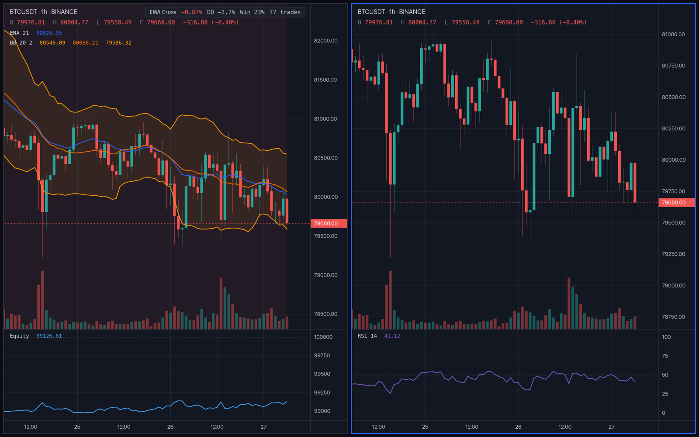

# Persephone

A backtesting app with no interface but its charts. It opens to one TradingView-style chart;
a right click adds indicators and strategies, and a key splits the window into more charts,
tiled the way Hyprland tiles windows. Every backtest runs on
[NautilusTrader](https://github.com/nautechsystems/nautilus_trader)'s Rust engine, and the same
strategies can paper trade on live Binance bars.



- **Charts** drawn on the GPU: candles, volume, built-in indicators (SMA, EMA, Bollinger, RSI,
  MACD, Stochastic, ATR, Donchian), drawings, and a crosshair synced across charts.
- **Tiling**, fixed like Hyprland's dwindle layout: up to 16 charts per workspace, nine
  workspaces, all saved.
- **Backtests** on Nautilus, with trade markers, an equity pane, a full report, and parameter
  sweeps compared side by side.
- **Your own indicators and strategies** as sandboxed WebAssembly plugins (Rust SDK), which
  can run ONNX models and ask language models, or as any process (Python, …) reached over a
  socket.
- **Data:** Binance spot, your own CSV tick files (trades or quotes, almost any layout), and
  Binance's bulk archives. Tick data backtests fill on ticks.
- **Paper and live trading** of the same strategies through Nautilus's live node.

## Run it

You need [Rust](https://rustup.rs). The repository pins the toolchain, so `rustup` installs
the right version on first build.

```bash
cargo run -p persephone --release
```

The first build takes several minutes. The app opens a Binance BTCUSDT 1-minute chart, and
your last layout on later launches. To open one particular market without touching the saved
layout:

```bash
cargo run -p persephone --release -- ETHUSDT 15m
```

The command-line tools (backtests, imports, plugins, live trading) are in `persephone-cli`:

```bash
cargo run -p persephone-cli --release -- --help
```

## Keys

Mod is ⌥ Option on macOS and Alt elsewhere. Keys follow physical positions, so they work on
any keyboard layout.

| Keys | Action |
|---|---|
| Mod+Enter | new chart |
| Mod+Q | close chart |
| Mod+H/J/K/L or arrows | move focus |
| Mod+Shift+H/J/K/L | swap charts |
| Mod+Ctrl+H/J/K/L | move the divider |
| Mod+T | toggle split direction |
| Mod+F | fullscreen |
| Mod+1…9 | switch workspace |
| Mod+Shift+1…9 | move chart to workspace |
| Esc | close a menu, stop drawing |

On a chart: right-click for the menu. Click the symbol in the top-left header to search for
another market right there, or the timeframe for a dropdown of the others. Drag to pan and scroll to zoom. Drag the price axis to stretch prices
and the time axis to stretch time; double-click either to reset it.

## Documentation

- [User guide](docs/guide.md): charts, strategies and reports, sweeps, drawings, your own
  data, paper and live trading, where files live.
- [Writing plugins](docs/plugins.md): indicators and strategies in Rust, models and AI,
  external strategies in Python or anything else.
- [Design plan](docs/plan.md): architecture and the decisions behind it.

## Project layout

| Crate | What it does |
|---|---|
| `crates/app` | the app (`persephone`) |
| `crates/cli` | command-line tools (`persephone-cli`) |
| `crates/chart` | the GPU chart widget |
| `crates/tiling` | the dwindle layout |
| `crates/engine` | the only crate that uses Nautilus: backtests and live sessions |
| `crates/plugin-host` | runs WebAssembly plugins and external strategies |
| `crates/sdk` | the plugin SDK |
| `crates/data` | Binance data, the local tick store, the CSV importer |
| `crates/ml` | ONNX models and language models for plugins |
| `crates/core` | shared types |
| `plugins/` | example plugins (a workspace of its own, built for `wasm32-wasip2`) |

`cargo test --workspace` runs the tests. Some build the example plugins first, so the first
run takes a while.

## License

Not chosen yet. Persephone builds on NautilusTrader, which is LGPL-3.0.
